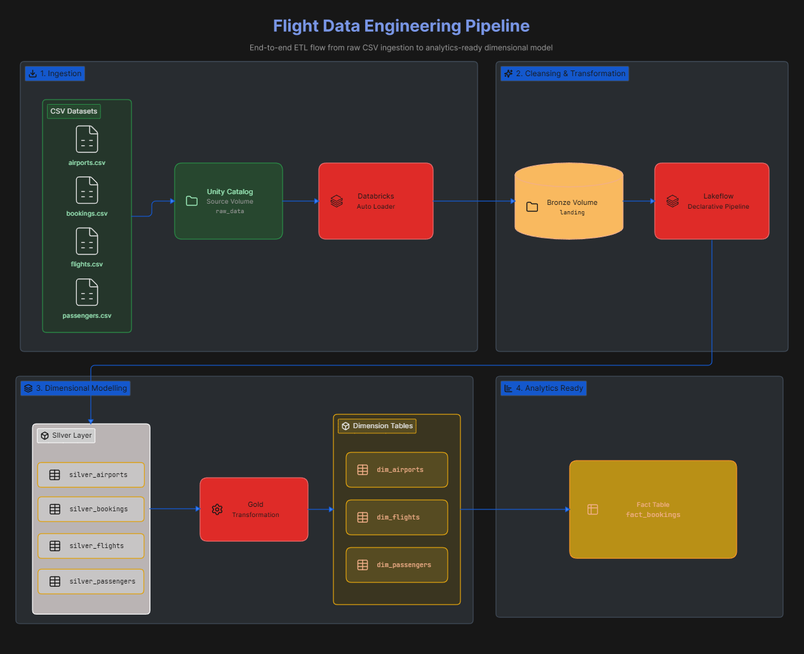

# Hi, I'm Davin Zoe Akhmad

Applied Data Science student at **Politeknik Elektronika Negeri Surabaya (PENS)**, focused on **cloud computing** and **data engineering**.

I learn by building end-to-end data pipelines and writing step-by-step guides, so that other people can repeat the work and learn from it.

## What I'm Focused On

- Building cloud data pipelines on **Google Cloud** and **Databricks**
- Learning **cloud fundamentals** and **serverless computing**
- Documenting what I build so it is easy to follow and reproduce

## Featured Projects

### [Medallion Data Pipeline on Google Cloud](https://github.com/davinzoed/gcp-medallion-ecommerce)

A serverless-first batch pipeline that turns raw e-commerce CSV files into an analytics-ready star schema in BigQuery, using the medallion architecture (Bronze, Silver, Gold) and orchestrated by a 12-task Airflow DAG on Cloud Composer.

  

- Cleans 34,000+ records with PySpark on Dataproc Serverless
- Includes a BigQuery `ASSERT`-based data quality gate
- Applies IAM with scoped roles and no downloaded keys, VPC Private Google Access, and cost control
- Comes with a step-by-step setup and teardown guide

**Stack:** Cloud Storage, Dataproc Serverless, BigQuery, Cloud Composer, Apache Airflow, PySpark, SQL, IAM

### [Flight Data Engineering Pipeline](https://github.com/davinzoed/flight-try)

An end-to-end pipeline on the Databricks Lakehouse Platform that models raw airline booking data into a star schema using the medallion architecture.

  

- Incremental ingestion with Auto Loader into Delta Lake
- Silver layer built with Lakeflow Declarative Pipelines
- Reusable dimension and fact builders with Delta Lake `MERGE`, Slowly Changing Dimensions, and surrogate keys
- Orchestrated with Databricks Workflows and governed with Unity Catalog

**Stack:** Databricks, Unity Catalog, Delta Lake, PySpark, Spark SQL, Auto Loader, Lakeflow Declarative Pipelines

## Tech Stack

| Area | Tools |
| --- | --- |
| Cloud | Google Cloud Platform (Cloud Storage, BigQuery, Dataproc Serverless, Cloud Composer, IAM, VPC), Databricks |
| Data Engineering | Apache Airflow, Apache Spark, PySpark, Delta Lake, Unity Catalog, ETL pipelines, Medallion Architecture, Dimensional Modeling |
| Programming and Tools | Python, SQL, Git, GitHub, Linux, Jupyter Notebook |

## Certifications

- [Google Cloud Certified Professional Data Engineer Specialization](https://coursera.org/share/bff1d8b56419682e1ee1d70e9f7eacca) (Whizlabs via Coursera), Oct 2026
- [Build Data Lakes and Data Warehouses on Google Cloud](https://coursera.org/share/6e3563b6eb9592c0ab74effd5207a423) (Google Cloud via Coursera), Oct 2026
- [Build Batch Data Pipelines on Google Cloud](https://coursera.org/share/ed2d9bc4982868aaba3a562065723250) (Google Cloud via Coursera), Oct 2026
- [IBM Data Science Professional Certificate](https://coursera.org/share/cc86e17948b4683d788cb621ce1e1f1a) (IBM via Coursera), Sep 2026
- [Data Engineer Certification](https://www.datacamp.com/certificate/DE0012864280379) (DataCamp), Jun 2026

## Connect With Me

- LinkedIn: [linkedin.com/in/davinzoed](https://www.linkedin.com/in/davinzoed)
- Email: [davinzoed@gmail.com](mailto:davinzoed@gmail.com)
